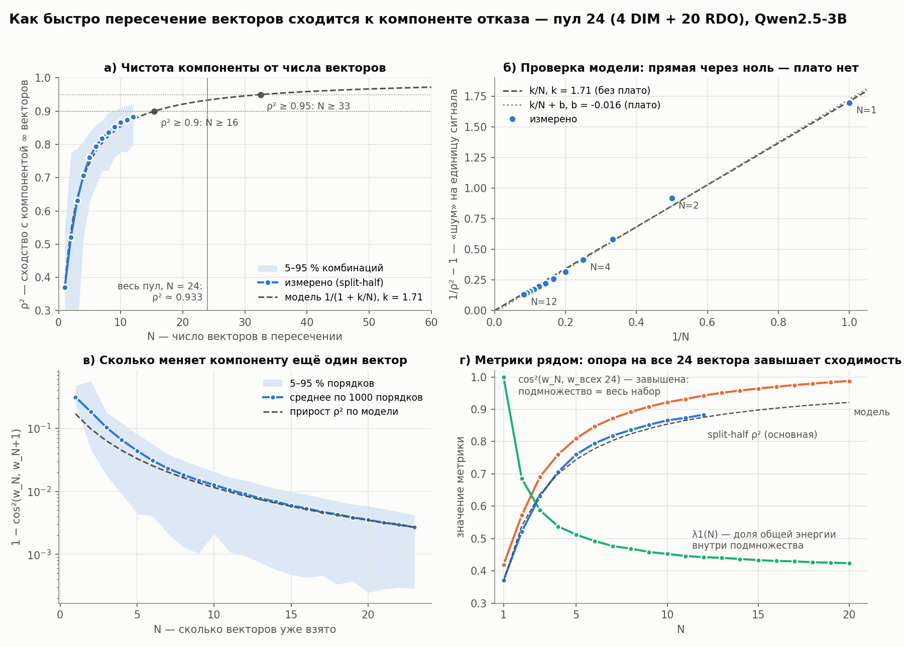

# Что мы делаем

Ищем у Qwen2.5-3B-Instruct **одну общую компоненту отказа** для разных доменов вреда.
Домены — четыре раздела SALAD-Bench (`OpenSafetyLab/Salad-Data`, `base_set`, поле `1-category`):

| код | домен |
|---|---|
| O1 | Representation & Toxicity |
| O2 | Misinformation Harms |
| O5 | Malicious Use |
| O6 | Human Autonomy & Integrity |

Внутри каждого домена есть два независимых способа найти направление отказа: DIM и RDO.
Мы пересекаем все полученные векторы, выделяем общую часть и проверяем, что она значит
для модели.

## Данные (этап 0, `00_data`)

- **Harmful** — вопросы своего домена SALAD-Bench. В каждом домене берём непересекающиеся
  train / val / test по **900 / 128 / 128**. Выборка стратифицирована по листу таксономии
  (`3-category`). Вопросы, которые встречаются в нескольких доменах или повторяются,
  выброшены целиком. Размер упирается в O6: в нём всего 1717 вопросов.
- **Harmless** — срез Alpaca из форка `geometry-of-refusal`
  (`data/saladbench_splits/harmless_train.json`), **общий для всех доменов**
  и тоже разбитый на 900 / 128 / 128.
- Фильтр, как у Arditi et al.: из harmful оставляем вопросы, на которых модель отказывает,
  из harmless — на которых не отказывает. Например, в O1 из 900 harmful_train остаётся 575.
- Ревизия датасета на HF зафиксирована в конфиге (`dataset.hf_revision`), sha256 каждого
  файла сплита записывается в `manifest.json`.

## Как получаем компоненту

1. **DIM на каждый домен (этап 1, `01_directions`).** Это difference-in-means: средняя активация на
   harmful_train домена минус средняя на общем harmless_train. Точку извлечения
   (позиция токена, слой) выбираем **один раз для всех доменов**: `select_direction`
   на объединённом harmful_val по среднему DIM доменов. Получилось **pos = −1, layer = 27**.
   Так все четыре DIM сравнимы между собой и различаются только harmful-стороной.

2. **Одномерные конусы RDO (этап 1, `01_directions`).** Метод Wollschläger et al. (`rdo.py` из форка;
   сам метод не менялся): конус размерности 1, то есть просто один вектор. Шаблон чата и
   refusal-токены передаются в `rdo.py` из `models.FAMILIES` — того же места, откуда их берёт
   аблация, а все гиперпараметры обучения записаны в конфиге (`rdo.hparams`). Цели для ablation и
   addition строятся по DIM своего домена, слой добавления — тот же 27. Обучение идёт на
   train-сплите домена с фильтром данных.
   На каждый домен 5 сидов, и **все 20 сидов разные**: O1 — 1–5, O2 — 6–10,
   O5 — 11–15, O6 — 16–20. Сид задаёт стартовый вектор и порядок батчей.

3. **Все векторы сохраняются по отдельности**, чтобы их можно было разделить и сравнить
   между собой:
   - `results/<запуск>/dim/<домен>/direction.pt` — DIM домена; там же `mean_diffs.pt`
     по всем точкам;
   - `results/<запуск>/rdo/<домен>/seed_XX.pt` — обученный `vector`, стартовый
     `init_vector`, кривые loss и bypass;
   - `results/<запуск>/directions/directions.pt` — все векторы одним набором с метаданными
     (метод, домен, сид, слой); `init.pt` — стартовые векторы RDO.

4. **Пересечение → общая компонента (этап 2, `02_component`).** Берём все 24 вектора (4 DIM + 20 RDO),
   нормируем и даём им равные веса. Общая компонента **w** — первый собственный вектор
   `P = (1/24) Σ v vᵀ`. Его собственное число λ1 равно среднему cos²(w, v): насколько
   w в среднем «сидит» во всех векторах. Для сравнения нужен случайный уровень: λ1 для
   24 случайных единичных векторов, 1000 повторов. Знак w выбираем так, чтобы
   cos(w, средний DIM) > 0.
   Состав популяции задаётся вариантом (`component.variants` в конфиге): основной — `all`,
   рядом считаются `dim_only` и `rdo_only`. Новый вариант (например, без части сидов) —
   запись в конфиге, пересчёт этапов 2 и 4 идёт на CPU.

5. **Доля энергии в каждом DIM (этап 4, `04_analysis`).** Для единичных векторов доля энергии DIM_d
   вдоль w равна cos²(w, DIM_d), остальное лежит вне w. Там же считаем контроль:
   не объясняется ли совпадение RDO общим стартом (cos² между w и стартовыми векторами).

6. **Аблитерация с w (этап 3, `03_ablation`).** Вычитаем проекцию на направление во всех слоях: на входе
   блока, на выходе attention и на выходе MLP, `h ← h − a·(h·v)v`, a ∈ {0.25, 0.5, 0.75, 1}.
   Замеряем:
   - **ASR** на harmful_test каждого домена — доля ответов, где отказ снят. Пока это
     прокси по первому токену (refusal-токены «I» / «As»); оценка через judge-модель
     запланирована на потом;
   - **KL** на harmless_test — насколько интервенция портит обычное поведение.

   Для сравнения так же аблируем DIM каждого домена, каждый из 20 RDO и 3 случайных вектора.
   Направления корректно сравнивать только при близком KL.

7. **Сходимость по числу векторов (этап 5, `05_convergence`).** Сколько направлений нужно,
   чтобы компонента была достаточно чистой. Векторы DIM и RDO не различаем. Для N = 1 … 20
   берём не больше 1000 случайных комбинаций (где их меньше — все). Основная метрика —
   **split-half**: две непересекающиеся половины по N векторов, ρ_N² ≈ |cos(w_A, w_B)| —
   сходство компоненты из N векторов с компонентой, которую дало бы бесконечное число
   векторов (ошибки половин независимы, поэтому опора на w всех 24 не нужна; N ≤ 12).
   По точкам подгоняется модель «общая часть + независимый шум» 1/ρ² − 1 = k/N и вариант
   с плато + b (b > 0 — систематическая часть, которую добавление векторов не убирает).
   Из неё — сколько векторов нужно для ρ² = 0.9 / 0.95 / 0.99 и прирост от очередного.
   Рядом: сдвиг компоненты от ещё одного вектора и cos²(w_N, w_всех) (завышена при больших N).

## Результаты первого прогона (12.10.2026)

Числа взяты из `results/qwen2.5-3b_salad-o1o2o5o6/reports/`, сами результаты лежат на сервере.
Запуск: `launch/qwen2.5-3b_salad-o1o2o5o6.sh`; этапы 0, 1 и 3 посчитаны 12.10 до разбиения
кода на этапы, этапы 2 и 4 пересчитаны 13.10 новым кодом — числа совпали бит в бит.

- **Общая компонента есть.** λ1 = 0.419 против случайного уровня 0.050 (p95 0.051);
  λ2 = 0.107.
- **Доля w в каждом DIM ≈ 0.51–0.54** (cos ≈ 0.71–0.73). При этом DIM доменов между собой
  почти совпадают: cos 0.95–0.99.
- **Аблация w:** при a = 0.25 средний ASR 0.973 при KL 0.038. У DIM при том же a ASR
  0.89–0.92 при KL 0.053–0.068. У RDO даже при a = 1 ASR 0.91–0.94 (KL ≈ 0.03).
  Случайные векторы дают ASR ≈ 0.31, на уровне без аблации (0.22–0.44).
- **Общий старт RDO совпадение не объясняет:** cos²(w, старт) ≈ 0.001.
- **w — компромисс между DIM и RDO.** По вариантам компоненты:

  | вариант | N | λ1 | доля w в DIM |
  |---|---|---|---|
  | `all` | 24 | 0.419 | 0.51–0.54 |
  | `dim_only` | 4 | 0.981 | 0.97–0.99 |
  | `rdo_only` | 20 | 0.422 | 0.28–0.30 |

  Общая часть самих RDO-направлений лежит заметно в стороне от DIM, а четыре DIM почти
  совпадают между собой.
- **Три RDO-сида выбиваются из общей картины:** s08 (O2), s12 (O5), s18 (O6).
  Их cos с w равен 0.16, −0.30 и 0.06. Loss обучения у них высокий (1.35, 1.47, 1.48 против
  1.1–1.3 у большинства), но не только у них: у s11 loss 1.44, а с w он согласуется (cos 0.61).
  Так что по loss их не отделить чисто. Отбрасывать сиды по их cos с w нельзя — это
  отбор по результату, он искусственно завысит λ1.

## Картинки

Картинки лежат в `docs/figures/`. Код для них в репозиторий не входит, данные — в
`results/<запуск>/` на сервере (путь указан у каждой картинки).

### Сходимость компоненты по числу векторов

Этап 5, запуск `qwen2.5-3b_salad-o1o2o5o6`, 13.10.2026. Данные:
`results/qwen2.5-3b_salad-o1o2o5o6/convergence/convergence.json`. Пул — 24 вектора (4 DIM +
20 RDO) без различия между ними; не больше 1000 комбинаций на N, сид 21.

- **а)** ρ² — сходство компоненты из N векторов с компонентой бесконечного числа векторов
  (split-half), с полосой 5–95 % комбинаций и моделью 1/(1 + k/N), k = 1.71. Для ρ² ≥ 0.9
  нужно 16 векторов, для 0.95 — 33; все 24 дают ρ² ≈ 0.93. Всё правее N = 12 —
  экстраполяция модели.
- **б)** Проверка модели: 1/ρ² − 1 против 1/N ложится на прямую через ноль, подгонка с
  плато даёт b = −0.016 ≈ 0. Систематической части, которую не убрать добавлением векторов,
  до N = 12 не видно.
- **в)** Насколько сдвигает компоненту ещё один вектор, 1 − cos²(w_N, w_{N+1}), по 1000
  случайным порядкам. Независимо от split-half совпадает с приростом ρ² по той же модели:
  11-й вектор добавляет ≈ 0.011, 21-й — ≈ 0.003.
- **г)** Метрики рядом. cos² с компонентой всех 24 векторов завышает сходимость (0.94 против
  0.88 при N = 12): подмножество почти совпадает с полным набором. λ1(N) — доля общей
  энергии внутри подмножества — спускается к 0.42 у полного набора.

## Что дальше

- Решить, что делать с выбивающимися сидами: критерий отбора должен быть независим от w
  (например, заранее заданный порог loss или bypass score), либо добавить сидов.
- Пересчитать этап 3 новым кодом: `ablation.json` сейчас в старом формате (строка `w` = `w:all`).
- Сравнить направления при одинаковом KL: подобрать a под целевой KL или построить
  кривые ASR(KL).
- Заменить прокси по первому токену на ASR от judge-модели.
- Перед запуском на Llama-3 исправить шаблон в `refusal_direction/pipeline/model_utils/llama3_model.py`
  форка: он начинается с лишней кавычки (`""""<|begin_of_text|>`), и DIM видел бы не тот промпт,
  что RDO. `directions.dim.check_family` на этом остановит этап 1.
