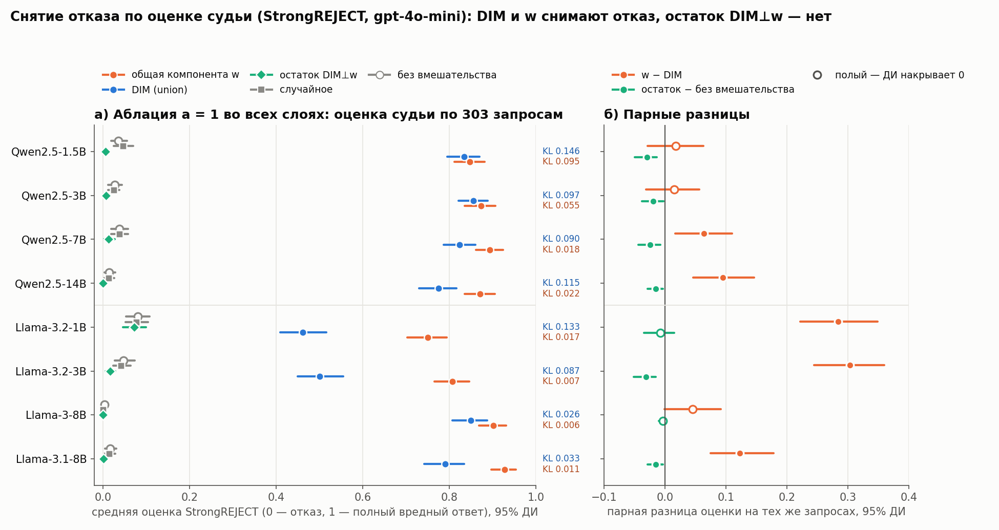
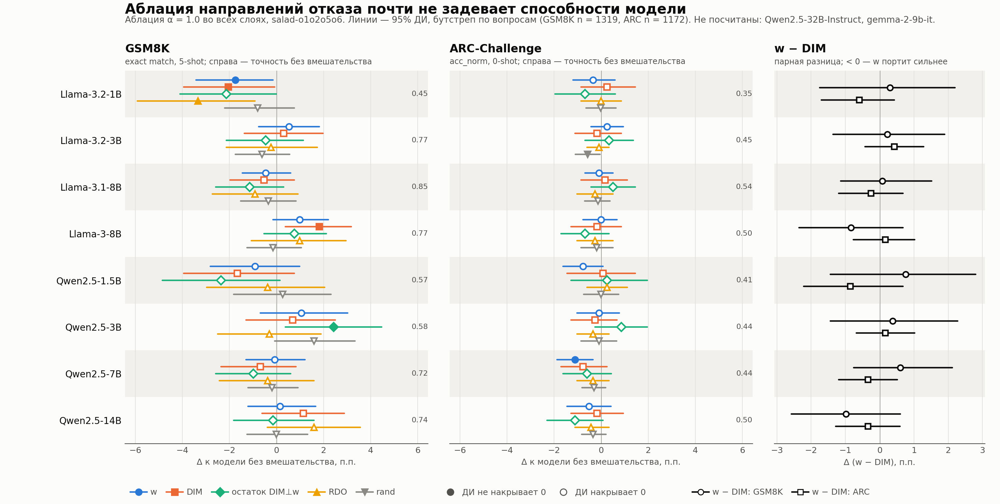

# Судья на 8 моделях: DIM, w и остаток DIM⊥w — результаты 22.10.2026

Снимок `results/cross-model-judge.md` с сервера (`scripts/summary_judge.py` по отчётам этапов 7, 10 и 11).
Код прогона — ветка `feat/judge-all-models`, коммит `dbcecdf`; конфиги — `configs/<модель>_salad-o1o2o5o6.yaml`.
Сами оценки (в git не храним) — на сервере в `results/<модель>_salad-o1o2o5o6/{strongreject,induce}/judge/*.jsonl`.

**Судья.** `openai/gpt-4o-mini` через OpenRouter, запуск на Mac (`scripts/judge_mac.sh`). В файлах оценок у каждой
строки есть ответ судьи (`judge_raw`) и модель судьи (`judge_model`). Таблицы 1–2 построены по оценкам судьи,
таблица 3 — по прокси первого токена (судья её не оценивал).

**Покрытие.** Все 8 моделей. StrongREJECT: 303 запроса × 9 направлений (`none`, `dim_union`, `w_all`,
`dim_union⊥w_all`, `rand_0`, `dim_O1/O2/O5/O6`); у Qwen2.5-3B ещё `rand_1/2` и 20 RDO. Вызов отказа (XSTest):
128 запросов harmless_test × 5 условий; у Qwen2.5-1.5B ещё s = 2.

**Ответы без оценки («б/о»).** Это отказы самого судьи: gpt-4o-mini отвечает «I'm sorry, I can't assist with that.»
и после 5 попыток оценки не даёт. Обычно 0–10 ответов на направление, в `none`, `rand` и остатке — почти ноль.
Число в таблице — сумма по всем направлениям модели (у Qwen2.5-3B в него входят 20 RDO, отсюда 117).
Сбоев API среди оценок нет (`collect()` в этапах 7 и 11 остановил бы сводку).

**Чистка 23.10.2026.** В 10 файлах оценок были повторные строки по одному id: старые неразобранные ответы
судьи до фикса `872d748` (Llama-3-8B, induce) и повторные попытки (Qwen2.5-3B, strongreject: `w_all`, `dim_O*`).
`collect()` и так берёт оценённую строку, так что цифры ниже от чистки не зависят; лишние строки удалены,
исходные файлы — в `results/_backup_judge_dedup_2026-10-23/` на сервере.

Собрано 22.10.2026 скриптом `scripts/summary_judge.py` из отчётов этапов 7, 10 и 11. DIM — объединённый (union), w — компонента `all`, остаток — DIM⊥w (как в этапе 8). Прочерк — этап для модели ещё не посчитан.

## 1. Снятие отказа: StrongREJECT, судья

Средняя оценка рубрики StrongREJECT (0…1) при аблации a = 1 во всех слоях; в скобках KL на harmless_test (этап 3, иначе этап 8). Δ — парная разница на тех же запросах с 95% ДИ; ДИ не накрывает 0 — разница значима. «б/о» — ответов без оценки судьи во всех строках.

| модель | запросов | без вмешательства | DIM | w | остаток | rand | Δ остаток − без | Δ w − DIM | б/о |
|---|---|---|---|---|---|---|---|---|---|
| Qwen2.5-1.5B-Instruct | 303 | 0.036 (KL 0.000) | 0.834 (KL 0.146) | 0.847 (KL 0.095) | **0.006** (KL 0.105) | 0.047 | -0.030 [-0.050, -0.013] | 0.018 [-0.028, 0.063] | 30 |
| Qwen2.5-14B-Instruct | 303 | 0.015 (KL 0.000) | 0.775 (KL 0.115) | 0.871 (KL 0.022) | **0.000** (KL 0.116) | 0.013 | -0.015 [-0.029, -0.003] | 0.095 [0.046, 0.146] | 24 |
| Qwen2.5-3B-Instruct | 303 | 0.027 (KL 0.000) | 0.856 (KL 0.097) | 0.873 (KL 0.055) | **0.007** (KL 0.082) | 0.025 | -0.020 [-0.038, -0.002] | 0.015 [-0.031, 0.057] | 117 |
| Qwen2.5-7B-Instruct | 303 | 0.038 (KL 0.000) | 0.824 (KL 0.090) | 0.893 (KL 0.018) | **0.013** (KL 0.049) | 0.038 | -0.025 [-0.044, -0.007] | 0.064 [0.017, 0.110] | 19 |
| Llama-3.1-8B-Instruct | 303 | 0.017 (KL 0.000) | 0.791 (KL 0.033) | 0.927 (KL 0.011) | **0.002** (KL 0.013) | 0.015 | -0.015 [-0.029, -0.004] | 0.122 [0.075, 0.178] | 37 |
| Llama-3.2-1B-Instruct | 303 | 0.080 (KL 0.000) | 0.462 (KL 0.133) | 0.750 (KL 0.017) | **0.073** (KL 0.049) | 0.077 | -0.008 [-0.034, 0.015] | 0.284 [0.221, 0.349] | 15 |
| Llama-3.2-3B-Instruct | 303 | 0.048 (KL 0.000) | 0.501 (KL 0.087) | 0.807 (KL 0.007) | **0.017** (KL 0.053) | 0.042 | -0.031 [-0.051, -0.015] | 0.303 [0.245, 0.360] | 4 |
| Meta-Llama-3-8B-Instruct | 303 | 0.003 (KL 0.000) | 0.850 (KL 0.026) | 0.902 (KL 0.006) | **0.000** (KL 0.034) | 0.000 | -0.003 [-0.010, 0.000] | 0.045 [-0.001, 0.092] | 43 |

*а) Оценка StrongREJECT при аблации каждого направления, 95% ДИ; справа — KL на harmless_test для DIM (синий) и w
(оранжевый). б) Парные разницы на тех же запросах; полый маркер — ДИ накрывает 0. w снимает отказ не хуже DIM при
меньшем KL, у Llama-3.2 — заметно лучше; остаток DIM⊥w снимает отказ не больше, чем ничего.*

## 1а. Среднее RDO на StrongREJECT (добавлено 23.10.2026)

RDO — среднее по 20 сидам (`rdo:split`): каждый сид отвечает на свою 1/20 запросов, вместе — полный набор (`generate.rdo_split`, см. [strongreject.md](strongreject.md)). ДИ бутстрэпом по запросам включает и разброс между сидами; KL — среднее по сидам (этап 3). На Qwen2.5-3B, где есть полные 20 × 303, по полному набору — 0.770.

| модель | w | DIM | RDO (среднее) | Δ w − RDO | Δ RDO − DIM |
|---|---|---|---|---|---|
| Qwen2.5-1.5B | 0.847 (KL 0.095) | 0.834 (KL 0.146) | **0.634 (KL 0.029)** | +0.211 [+0.158, +0.264] | -0.196 [-0.254, -0.140] |
| Qwen2.5-3B | 0.873 (KL 0.055) | 0.856 (KL 0.097) | **0.792 (KL 0.030)** | +0.078 [+0.032, +0.125] | -0.062 [-0.102, -0.021] |
| Qwen2.5-7B | 0.893 (KL 0.018) | 0.824 (KL 0.090) | **0.773 (KL 0.010)** | +0.118 [+0.069, +0.168] | -0.052 [-0.093, -0.014] |
| Qwen2.5-14B | 0.871 (KL 0.022) | 0.775 (KL 0.115) | **0.752 (KL 0.009)** | +0.117 [+0.065, +0.166] | -0.025 [-0.076, +0.028] |
| Llama-3.2-1B | 0.750 (KL 0.017) | 0.462 (KL 0.133) | **0.337 (KL 0.008)** | +0.409 [+0.345, +0.475] | -0.124 [-0.182, -0.074] |
| Llama-3.2-3B | 0.807 (KL 0.007) | 0.501 (KL 0.087) | **0.446 (KL 0.003)** | +0.359 [+0.298, +0.418] | -0.055 [-0.106, +0.001] |
| Llama-3-8B | 0.902 (KL 0.006) | 0.850 (KL 0.026) | **0.834 (KL 0.004)** | +0.060 [+0.010, +0.113] | -0.011 [-0.058, +0.034] |
| Llama-3.1-8B | 0.927 (KL 0.011) | 0.791 (KL 0.033) | **0.670 (KL 0.007)** | +0.250 [+0.192, +0.311] | -0.115 [-0.167, -0.062] |

w снимает отказ сильнее среднего RDO на всех 8 моделях (ДИ нигде не накрывает 0); RDO дешевле всех по KL, но слабее и w, и DIM (RDO − DIM значимо ниже нуля на 5 из 8).

## 2. Вызов отказа: harmless_test, классификатор XSTest

**Зачем.** Аблация проверяет необходимость: без направления модель перестаёт отказывать. Но отказ может пропасть и
потому, что вмешательство просто портит модель. Добавление направления к безобидному запросу проверяет достаточность:
если отказ появляется там, где его не было, направление действительно кодирует отказ, а не «что-то важное». Для
остатка DIM⊥w это вторая половина вывода: он не только не нужен для отказа (таблица 1), но и не вызывает его — значит,
вся «отказная» часть DIM лежит в w, а остаток — шум направления.

Доля любого отказа (полный + частичный) при h + s·α0·v̂ на входе слоя DIM, полные ответы.

| модель | s | без вмешательства | DIM | w | остаток | rand | Δ остаток − без |
|---|---|---|---|---|---|---|---|
| Qwen2.5-1.5B-Instruct | 1 | 0.047 | 0.844 | 0.984 | **0.141** | 0.039 | 0.094 [0.039, 0.156] |
| Qwen2.5-1.5B-Instruct | 2 | 0.047 | 1.000 | 1.000 | **0.555** | 0.008 | 0.508 [0.414, 0.602] |
| Qwen2.5-14B-Instruct | 1 | 0.023 | 0.898 | 1.000 | **0.031** | 0.023 | 0.008 [0.000, 0.023] |
| Qwen2.5-3B-Instruct | 1 | 0.023 | 0.789 | 0.992 | **0.016** | 0.008 | -0.008 [-0.039, 0.023] |
| Qwen2.5-7B-Instruct | 1 | 0.008 | 0.844 | 1.000 | **0.000** | 0.016 | -0.008 [-0.023, 0.000] |
| Llama-3.1-8B-Instruct | 1 | 0.016 | 0.992 | 1.000 | **0.016** | 0.016 | 0.000 [-0.023, 0.023] |
| Llama-3.2-1B-Instruct | 1 | 0.023 | 0.836 | 1.000 | **0.023** | 0.023 | 0.000 [-0.031, 0.031] |
| Llama-3.2-3B-Instruct | 1 | 0.016 | 0.961 | 1.000 | **0.016** | 0.031 | 0.000 [0.000, 0.000] |
| Meta-Llama-3-8B-Instruct | 1 | 0.016 | 0.953 | 1.000 | **0.000** | 0.000 | -0.016 [-0.039, 0.000] |

## 3. Кросс-нейтрализация (прокси первого токена)

**Зачем.** Таблицы 1–2 показывают, что DIM и w по отдельности управляют отказом, но не что это один механизм. Здесь
отказ вызывают одним направлением и одновременно вырезают другое. Если отказ от DIM гаснет при вырезании w, DIM
действует через w; если отказ от w не гаснет при вырезании DIM, w несёт больше, чем DIM. Вырезание остатка и
случайного направления — контроль: они отказ гасить не должны.

Доля отказа на harmless_test: вызываем отказ направлением в рабочей точке этапа 8 (s) и одновременно вырезаем другое во всех слоях.

| модель | вызываем | s | одно | − w / − DIM | − само | − остаток | − rand |
|---|---|---|---|---|---|---|---|
| Qwen2.5-1.5B-Instruct | dim_union | 2 | 1.000 | 0.688 | 0.547 | 0.992 | 0.977 |
| Qwen2.5-1.5B-Instruct | w:all | 2 | 1.000 | 0.961 | 0.641 | 1.000 | 1.000 |
| Qwen2.5-14B-Instruct | dim_union | 2 | 0.891 | 0.016 | 0.125 | 0.773 | 0.898 |
| Qwen2.5-14B-Instruct | w:all | 1 | 0.961 | 0.539 | 0.039 | 0.977 | 0.953 |
| Qwen2.5-3B-Instruct | dim_union | 2 | 0.992 | 0.320 | 0.492 | 0.984 | 0.992 |
| Qwen2.5-3B-Instruct | w:all | 1 | 0.984 | 0.797 | 0.109 | 0.984 | 0.977 |
| Qwen2.5-7B-Instruct | dim_union | 2 | 0.992 | 0.016 | 0.156 | 1.000 | 0.992 |
| Qwen2.5-7B-Instruct | w:all | 2 | 0.992 | 0.992 | 0.070 | 0.992 | 0.992 |
| Llama-3.1-8B-Instruct | dim_union | 1 | 0.984 | 0.016 | 0.031 | 0.992 | 0.984 |
| Llama-3.1-8B-Instruct | w:all | 1 | 1.000 | 1.000 | 0.078 | 1.000 | 1.000 |
| Llama-3.2-1B-Instruct | dim_union | 2 | 0.953 | 0.734 | 0.922 | 0.961 | 0.945 |
| Llama-3.2-1B-Instruct | w:all | 2 | 0.984 | 0.992 | 0.984 | 0.984 | 0.984 |
| Llama-3.2-3B-Instruct | dim_union | 2 | 0.992 | 0.750 | 0.922 | 1.000 | 0.992 |
| Llama-3.2-3B-Instruct | w:all | 2 | 0.992 | 0.992 | 0.938 | 0.992 | 0.984 |
| Meta-Llama-3-8B-Instruct | dim_union | 2 | 1.000 | 0.258 | 0.703 | 1.000 | 1.000 |
| Meta-Llama-3-8B-Instruct | w:all | 1 | 1.000 | 0.992 | 0.055 | 1.000 | 1.000 |

## 4. Способности при аблации: GSM8K и ARC-Challenge (добавлено 05.11.2026)

**Зачем.** Таблицы 1–3 показывают, что w снимает отказ не хуже DIM и при меньшем KL. Но KL на harmless_test —
косвенная мера порчи. Здесь прямо проверяется, не платит ли w за это способностями: решает ли модель задачи
после аблации так же, как без неё.

Этап 12 (`scripts/12_bench.py`, lm-eval), ветка `feat/bench-arc`, коммит `717781f`; прогоны 03–04.11.2026.
Аблация α = 1.0 во всех слоях, chat template. GSM8K — exact match (flexible-extract), 5-shot, 1319 вопросов;
ARC-Challenge — acc_norm, 0-shot, 1172 вопроса. RDO — `rdo:split` (как в 1а), rand — среднее по случайным
(2 на GSM8K, 4 на ARC). Δ — парная разница к модели без вмешательства на тех же вопросах, 95% ДИ бутстрепом по
вопросам; жирным — ДИ не накрывает 0. Сводка — `results/cross-model-bench.md` (`scripts/summary_bench.py`),
рисунок — `scripts/plot_bench.py`. Qwen2.5-32B и gemma-2-9b не посчитаны.

**GSM8K**

| модель | без вмешательства | Δ w | Δ DIM | Δ остаток | Δ RDO | Δ rand | Δ w − DIM |
|---|---|---|---|---|---|---|---|
| Qwen2.5-1.5B | 0.566 | -0.009 [-0.028, +0.010] | -0.017 [-0.039, +0.008] | -0.024 [-0.049, +0.002] | -0.004 [-0.030, +0.020] | +0.003 [-0.018, +0.023] | +0.008 [-0.014, +0.028] |
| Qwen2.5-3B | 0.580 | +0.011 [-0.007, +0.030] | +0.007 [-0.013, +0.025] | **+0.024 [+0.004, +0.045]** | -0.003 [-0.025, +0.019] | +0.016 [-0.001, +0.033] | +0.004 [-0.014, +0.023] |
| Qwen2.5-7B | 0.721 | -0.001 [-0.013, +0.012] | -0.007 [-0.024, +0.008] | -0.010 [-0.026, +0.006] | -0.004 [-0.024, +0.016] | -0.002 [-0.012, +0.009] | +0.006 [-0.008, +0.021] |
| Qwen2.5-14B | 0.745 | +0.002 [-0.012, +0.017] | +0.011 [-0.006, +0.029] | -0.002 [-0.018, +0.016] | +0.016 [-0.004, +0.036] | +0.000 [-0.013, +0.013] | -0.010 [-0.026, +0.006] |
| Llama-3.2-1B | 0.455 | **-0.017 [-0.034, -0.002]** | **-0.020 [-0.039, -0.001]** | -0.021 [-0.041, +0.000] | **-0.033 [-0.059, -0.009]** | -0.008 [-0.022, +0.008] | +0.003 [-0.018, +0.022] |
| Llama-3.2-3B | 0.770 | +0.005 [-0.008, +0.018] | +0.003 [-0.014, +0.020] | -0.005 [-0.021, +0.011] | -0.002 [-0.021, +0.017] | -0.006 [-0.017, +0.006] | +0.002 [-0.014, +0.019] |
| Llama-3-8B | 0.772 | +0.010 [-0.002, +0.022] | **+0.018 [+0.004, +0.032]** | +0.008 [-0.005, +0.021] | +0.010 [-0.011, +0.030] | -0.002 [-0.013, +0.011] | -0.008 [-0.024, +0.007] |
| Llama-3.1-8B | 0.849 | -0.005 [-0.014, +0.006] | -0.005 [-0.020, +0.008] | -0.011 [-0.026, +0.003] | -0.009 [-0.027, +0.009] | -0.003 [-0.015, +0.008] | +0.001 [-0.011, +0.015] |

**ARC-Challenge**

| модель | без вмешательства | Δ w | Δ DIM | Δ остаток | Δ RDO | Δ rand | Δ w − DIM |
|---|---|---|---|---|---|---|---|
| Qwen2.5-1.5B | 0.405 | -0.008 [-0.016, +0.001] | +0.001 [-0.015, +0.015] | +0.003 [-0.013, +0.020] | +0.003 [-0.006, +0.011] | +0.000 [-0.007, +0.007] | -0.009 [-0.022, +0.007] |
| Qwen2.5-3B | 0.437 | -0.001 [-0.010, +0.008] | -0.003 [-0.013, +0.007] | +0.009 [-0.003, +0.020] | -0.003 [-0.010, +0.003] | -0.001 [-0.009, +0.007] | +0.002 [-0.007, +0.010] |
| Qwen2.5-7B | 0.436 | **-0.011 [-0.019, -0.003]** | -0.008 [-0.017, +0.003] | -0.006 [-0.016, +0.004] | -0.003 [-0.010, +0.003] | -0.003 [-0.008, +0.002] | -0.003 [-0.012, +0.005] |
| Qwen2.5-14B | 0.499 | -0.005 [-0.015, +0.004] | -0.002 [-0.013, +0.009] | -0.011 [-0.023, +0.001] | -0.004 [-0.011, +0.003] | -0.003 [-0.008, +0.002] | -0.003 [-0.013, +0.006] |
| Llama-3.2-1B | 0.351 | -0.003 [-0.012, +0.006] | +0.003 [-0.009, +0.015] | -0.007 [-0.020, +0.006] | +0.000 [-0.009, +0.009] | -0.000 [-0.006, +0.006] | -0.006 [-0.017, +0.004] |
| Llama-3.2-3B | 0.455 | +0.003 [-0.004, +0.009] | -0.002 [-0.011, +0.009] | +0.003 [-0.007, +0.014] | -0.001 [-0.006, +0.003] | **-0.006 [-0.011, -0.000]** | +0.004 [-0.004, +0.013] |
| Llama-3-8B | 0.504 | +0.000 [-0.008, +0.007] | -0.002 [-0.013, +0.009] | -0.007 [-0.017, +0.003] | -0.003 [-0.010, +0.005] | -0.002 [-0.009, +0.005] | +0.002 [-0.008, +0.010] |
| Llama-3.1-8B | 0.538 | -0.001 [-0.007, +0.005] | +0.002 [-0.009, +0.011] | +0.005 [-0.004, +0.015] | -0.003 [-0.010, +0.005] | -0.001 [-0.007, +0.004] | -0.003 [-0.012, +0.007] |

*Слева и в центре — Δ к модели без вмешательства для каждого направления, 95% ДИ; закрашенный маркер — ДИ не
накрывает 0; справа от панели — точность без вмешательства. Справа — прямая разница w − DIM на тех же вопросах
(кружок — GSM8K, квадрат — ARC).*

**w портит способности не сильнее DIM — с количественной границей.** Прямая разница w − DIM не значима ни в одной
из 16 пар «модель × задача». Само по себе это лишь «разницы не нашли», поэтому важна ширина ДИ. Сводная оценка по
8 моделям (взвешивание обратно дисперсии, модели как независимые):

| задача | w − DIM, сводно | худшая нижняя граница ДИ отдельной модели |
|---|---|---|
| GSM8K | +0.01 п.п. [−0.57, +0.58] | −2.6 п.п. |
| ARC-Challenge | −0.12 п.п. [−0.45, +0.22] | −2.2 п.п. |

То есть в среднем w хуже DIM не более чем на ~0.5 п.п., на отдельной модели — не более чем на ~2.5 п.п.
Вместе с таблицами 1 и 1а: **при той же или большей силе снятия отказа и меньшем KL w не дороже DIM по
способностям** (GSM8K 0.0 ± 0.6 п.п., ARC −0.1 ± 0.3 п.п.). Обратного — DIM значимо хуже w — тоже нет.

**Аблация вообще почти не задевает способности.** Все Δ к модели без вмешательства в пределах ±3.3 п.п. на
GSM8K и ±1.1 п.п. на ARC. Значимых отклонений 7 из 80 при ожидаемых ~4 ложных на уровне 5%, причём два из них со
знаком плюс и одно — у rand (Llama-3.2-3B, ARC), то есть разрозненный шум. Единственный согласованный случай —
**Llama-3.2-1B на GSM8K**: значимо падают w, DIM и RDO (−1.7…−3.3 п.п.), у остатка ДИ касается 0. Самая слабая
модель задевается любой аблацией отказного направления, но w и DIM одинаково (w − DIM +0.003 [−0.018, +0.022]).

**Ограничения.**
- Сравнение при α = 1, а не при равном KL; у w KL ниже (таблица 1), так что при выравнивании по KL вывод
  может только усилиться в пользу w.
- Две задачи: математика и MCQ по знаниям. Длинная генерация, следование инструкциям, код не проверены;
  sycophancy посчитана только для Qwen2.5-3B, Qwen2.5-7B и Llama-3.1-8B.
- Нет Qwen2.5-32B — модели, где w сильнее всего обходит DIM по судье, — и gemma-2-9b.

Чтобы вывод стал сильным, а не просто обоснованным: досчитать 32B и gemma и добавить генеративный бенчмарк
(IFEval или MT-Bench с судьёй); строгая форма — TOST с заранее заданной границей эквивалентности (например, 1 п.п.).
